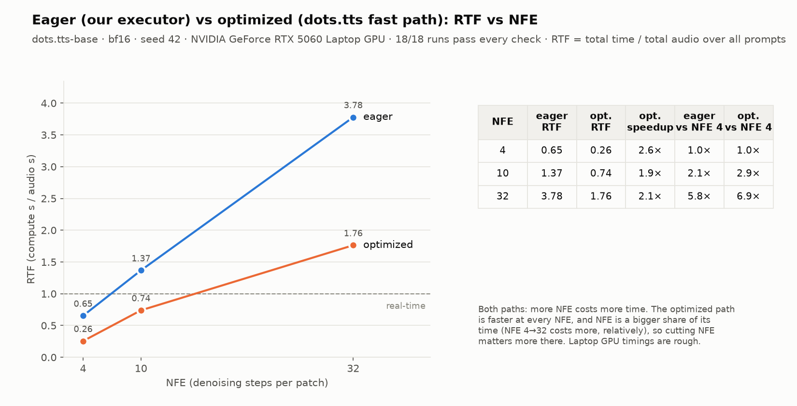

# adaptive-nfe

Internal repo for the WAT.ai GPU systems team. Setting up the baseline for the NFE scheduler and GPU execution calls on dots.tts. Testing with a fixed scheduler first (same NFE every patch) to make sure hooking in doesn't change anything.

## Folders

- `patches/`: our edit to dots.tts (the scheduler and executor hooks), saved as a git patch so anyone can apply it to their clone
- `src/adaptive_nfe/`: the scheduler (`scheduler.py`), the DiT executor (`executor.py`, `ode.py`), and `generate_fixed_nfe` (`fixed_nfe.py`: one NFE frozen for a whole utterance)
- `scripts/`: setup (`setup_env.sh`), the comparison test (`check_equivalence.py`), the ml-evals benchmark runner (`run_benchmark.py`), the demo command (`generate.py`: prompt + NFE → WAV), `plot_results.py` (results CSV → PNGs), and `inspect_dit.py` for poking at the DiT
- `tests/`: fast checks that need no model weights (`pytest tests/`), plus `test_fixed_nfe_gpu.py`, which runs the real model and skips without CUDA
- `docs/design/`: executor design (`executor-baseline.md`) and next-phase notes (`batching-exploration.md`)
- `results/`: committed result tables (CSV) and charts (PNG)
- `runs/`: raw outputs from running the scripts (reports, wavs). Not committed, it's in .gitignore

## What's going on

dots.tts makes audio one patch (~160 ms) at a time, and each patch gets `num_steps` denoising steps from the DiT. Right now every patch gets the same number. Plan is to let a scheduler pick it per patch.

Before doing anything smart, we checked that plugging a scheduler in gives the exact same output as stock dots.tts when it just returns a constant.

- `patches/dots_tts_scheduler_hook.patch`: small change to dots.tts `model.py`. Adds `model.nfe_scheduler` and `model.dit_executor` (both None by default). If a scheduler is set, it gets asked for `num_steps` before each patch. If an executor is set, it runs the DiT for the patch instead of dots.tts's own solver (eager flow matching only, errors otherwise).
- `src/adaptive_nfe/scheduler.py`: `Scheduler` base class (logs every choice) and `FixedScheduler(n)`.
- `scripts/check_equivalence.py`: the test. Same seed, for each text and NFE N it runs stock twice (A, A2) and once with `FixedScheduler(N)` (B). B is called with `num_steps=1` so it only passes if the hook actually works. Compares every patch and the final audio with `torch.equal`, and counts DiT calls per patch.
- `scripts/inspect_dit.py`: dumps velocity per step + EOS prob per patch. Might be useful later for deciding which patches are "hard".

All eager mode (`optimize=False`), bf16, seed 42, dots.tts commit `3cb6f94`.

## Results

First run (Oct 11, RTX 5060 Laptop 8 GB, torch 2.8.0+cu128): **all pass**. FixedScheduler output is bit for bit identical to stock at every NFE, and stock matches itself run to run, so exact comparison works on GPU.

| text | NFE | patches | stock vs stock | stock vs FixedScheduler | DiT calls per patch |
|---|---|---|---|---|---|
| "Hello, this is a quick speech synthesis test." | 4 | 23 | identical | identical | 4 |
| | 10 | 22 | identical | identical | 10 |
| | 32 | 21 | identical | identical | 32 |
| "The scheduler decides how many denoising steps each patch of audio receives." | 4 | 29 | identical | identical | 4 |
| | 10 | 27 | identical | identical | 10 |
| | 32 | 28 | identical | identical | 32 |

"Identical" means `torch.equal` on every patch and on the final waveform. Patch count changes a bit with NFE because the audio comes out slightly different, so the EOS head stops at a different point.

**Executor** (`--executor`, same setup, torchdiffeq 0.2.5): **all pass**. Running B through `adaptive_nfe.Executor` instead of dots.tts's solver gives the same table: every patch and the waveform identical to stock, same patch counts (23/22/21, 29/27/28), N DiT calls per patch, and every patch went through the executor. `pytest tests/`: 163 passed.

**Demo command** (`generate.py --verify-stock`, Oct 23, dots.tts-base, same setup): **all pass**. Prompt + NFE → WAV through the executor, 3 benchmark prompts × NFE 4/10/32. Every run: the chosen NFE on every patch, the executor decoded every patch, audio identical to stock (sample hash).

| prompt | NFE | patches | audio | time | RTF |
|---|---|---|---|---|---|
| p001 (short) | 4 | 15 | 2.40 s | 2.0 s | 0.84 |
| | 10 | 15 | 2.40 s | 7.0 s | 2.90 |
| | 32 | 18 | 2.88 s | 14.0 s | 4.88 |
| p004 (medium) | 4 | 39 | 6.24 s | 5.1 s | 0.82 |
| | 10 | 41 | 6.56 s | 9.1 s | 1.39 |
| | 32 | 32 | 5.12 s | 26.4 s | 5.15 |
| p007 (long) | 4 | 72 | 11.52 s | 10.5 s | 0.91 |
| | 10 | 77 | 12.32 s | 21.0 s | 1.71 |
| | 32 | 76 | 12.16 s | 57.9 s | 4.76 |

Times are from a laptop GPU and jump around (p004 NFE 10 took 432 s the first time with the lid closed, 9.1 s on rerun), so don't quote them as latency numbers.

**Eager vs optimized** (Oct 31, dots.tts-base, same laptop, both sweeps back to back): **18/18 pass**. Same 3 prompts × NFE 4/10/32 on both paths, each checked against stock on the same path. Eager: our executor runs every patch, audio identical to stock eager. Optimized (`--optimize`: torch.compile + KV cache): our scheduler sets the NFE on every patch and dots.tts's own fast loop runs it (the executor doesn't do the fast path yet), audio identical to stock optimized.

| NFE | eager RTF | optimized RTF | optimized speedup | eager cost vs NFE 4 | optimized cost vs NFE 4 |
|---|---|---|---|---|---|
| 4 | 0.65 | 0.26 | 2.6× | 1.0× | 1.0× |
| 10 | 1.37 | 0.74 | 1.9× | 2.1× | 2.9× |
| 32 | 3.78 | 1.76 | 2.1× | 5.8× | 6.9× |

RTF here = total time / total audio over the 3 prompts. Cutting NFE saves time on both paths, and relatively more on the optimized one, since the DiT steps are a bigger share of its time. The two paths do slightly different math (fast path: exact 1/NFE grid), so their audio differs from each other; each matches its own stock. Optimized p007 NFE 32 peaked at 9.6 GB on an 8 GB card (WSL spills into shared memory), which is probably why that run is slower than the trend.

Per-run tables + charts: `results/generate_base_eager_vs_optimized_2026-10-31{.csv,_eager.png,_optimized.png,_compare.png}`.



## Running it

WSL/Linux only (pynini won't build on Windows).

```bash
git clone https://github.com/Adaptive-Compute-For-TTS/adaptive-nfe.git
git clone https://github.com/studio-dots-ai/dots.tts.git
cd dots.tts && git switch -c scheduler-hook 3cb6f94
git apply ../adaptive-nfe/patches/dots_tts_scheduler_hook.patch
cd ../adaptive-nfe && bash scripts/setup_env.sh && source .venv/bin/activate
python scripts/check_equivalence.py --nfe 4 10 32
```

First run downloads the weights. Output ends up in `runs/equivalence/<timestamp>/`.

### Executor

`adaptive_nfe.Executor` runs the DiT for one patch at a given NFE (eager, Euler, one request) and must reproduce stock exactly. Design: `docs/design/executor-baseline.md`.

```bash
pytest tests/                                                  # no weights, CPU, seconds
python scripts/check_equivalence.py --nfe 4 10 32 --executor   # full model through the executor
```

### ml-evals benchmark

`run_benchmark.py` runs the 54 prompts from [ml-evals](https://github.com/Adaptive-Compute-For-TTS/ml-evals) with the same settings and output layout as Nishant's `run_baseline.py` (soar, 10 steps, euler, CFG 1.2, seed 42), so the output can be scored by tts_eval_org. `--mode stock|scheduler|executor` picks the path. Expects `ml-evals` cloned next to this repo.

```bash
python scripts/run_benchmark.py --mode stock    --out-dir runs/benchmark/soar_steps10_stock
python scripts/run_benchmark.py --mode executor --out-dir runs/benchmark/soar_steps10_executor \
    --compare-to runs/benchmark/soar_steps10_stock/manifest.json
```

Compare runs with `audio_sha256`, not `wav_sha256`: float WAVs get a timestamped header chunk so the file hash changes every run. NFE = num_steps everywhere (team convention). Nishant's first baseline says `nfe_estimate: 20`, that's the old CFG x 2 count, it's NFE 10.

### Demo command (prompt + NFE → WAV)

```bash
python scripts/generate.py --prompt-id p004 --nfe 10 --verify-stock   # eager, our executor runs the DiT loop
python scripts/generate.py --prompt-id p004 --nfe 10 --optimize       # dots.tts fast path (~3 min compile), stock DiT loop
python scripts/generate.py --prompt-id p001 p004 p007 --nfe 4 10 32 --optimize --verify-stock --run-id opt   # sweep, one model load
python scripts/plot_results.py results/<table>.csv                      # PNGs from a results CSV
```

Several `--prompt-id`/`--nfe` values run every combination in one process (one model load / compile, one discarded warmup per NFE). Writes `runs/generate/<run_id>/` per run with `audio.wav`, `config.json`, `metrics.json` (nfe per patch, time, RTF, peak VRAM, checks). `--text`, `--ref-audio`/`--ref-text` also work. The executor doesn't support `--optimize` yet (its KV cache is built per NFE).

### From Python (selector hookup)

`generate.py` is a wrapper around `generate_fixed_nfe`, which is the call a selector hands its NFE to. It takes the NFE once, freezes it for every patch, runs each patch through the executor, and raises if any patch got a different NFE or skipped the executor. Hooks are restored afterwards.

```python
from adaptive_nfe import generate_fixed_nfe

torch.manual_seed(42)                      # seeding is the caller's job
result = generate_fixed_nfe(rt, nfe=10, text="Hello there.", guidance_scale=1.2)
result.output["audio"], result.num_patches, result.nfe_per_patch
```

```bash
pytest tests/test_fixed_nfe_gpu.py -v      # real model on CUDA: frozen NFE, executor on every patch, identical to stock
ADAPTIVE_NFE_MODEL=dots-studio/dots.tts-soar pytest tests/test_fixed_nfe_gpu.py -v
```

## Todo

- executor on the optimized path (`optimized-executor` branch): own the fast-path loop, equivalent to stock `--optimize`
- actual variable NFE scheduler
- sort out logging format + executor interface with everyone
